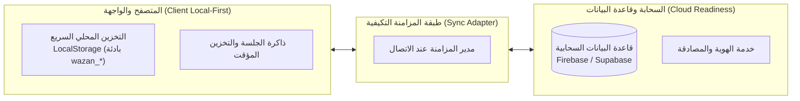
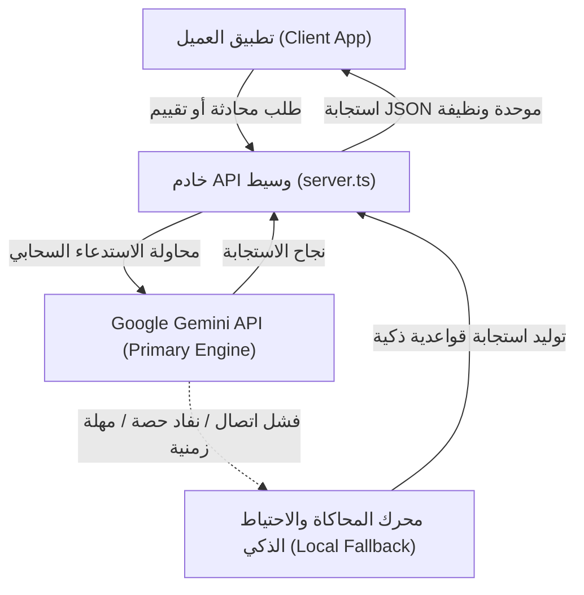
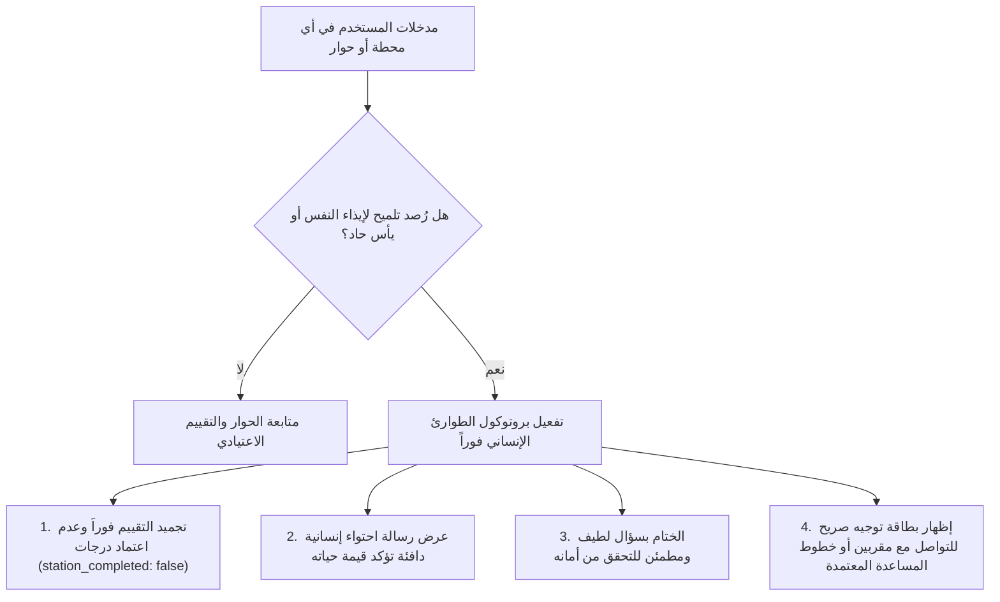
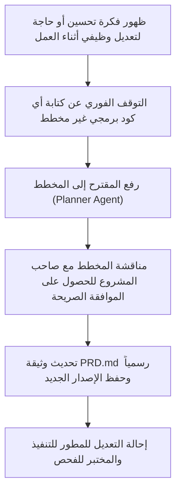

# وثيقة متطلبات المنتج (PRD) — منصة وزان (Wazan)
## نظام حوكمة وتوازن الحياة بالذكاء الاصطناعي التكيفي (AI Life Governance Platform)

---

### بيانات الوثيقة والتحكم بالإصدار
- **اسم المنتج**: منصة وزان (Wazan Life Balance Platform)
- **الإصدار الحالي**: 1.1.0 (تحديث منطق التقييم الأسبوعي واستقلالية استشارة المستشارين)
- **تاريخ الاعتماد النهائي**: نوفمبر 2026
- **المخطط الهندسي**: Planner Agent (وكيل التخطيط الهندسي وتجربة المستخدم)
- **الحالة**: معتمدة ومحدثة وفق حوكمة التغيير (Approved & Updated via RFC) ✅

---

### جدول مراحل إعداد الوثيقة (Phases Roadmap)

| المرحلة | موضوع المرحلة | الحالة |
| :--- | :--- | :--- |
| **المرحلة 1** | **المتطلبات والتصميم الوظيفي ومسارات المستخدم (Functional Design & User Flows)** | **معتمدة رسمياً (Approved) ✅** |
| **المرحلة 2** | **هندسة الذكاء الاصطناعي وهيكلة البيانات (AI Engine & Data Architecture)** | **معتمدة رسمياً (Approved) ✅** |
| **المرحلة 3** | **المتطلبات غير الوظيفية، الأمان، والحوكمة (Non-Functional & Guardrails)** | **معتمدة رسمياً (Approved) ✅** |
| **المرحلة 4** | **خطة الاعتماد، التحقق، والتسليم (Testing & Developer Handoff)** | **معتمدة رسمياً (Approved) ✅** |

---

# المرحلة 1: المتطلبات والتصميم الوظيفي (Functional Requirements & User Journeys)

## 1. الرؤية وجوهر المنتج (Product Philosophy)
**"وزان"** هي منصة ويب تفاعلية باللغة العربية (`RTL`) بنظام حوكمة وإرشاد متكامل لأسلوب الحياة، تهدف إلى إخراج المستخدم من دوامة الفوضى وتشتت الأولويات عبر:
1. تقييم تفاعلي تكيفي يُحاكي حواراً عيادياً مع 8 مستشارين متخصصين لبناء **عجلة الحياة (Wheel of Life)**.
2. تشخيص شمولي يربط أبعاد الحياة ويكتشف **عنق الزجاجة الحياتي (Critical Bottleneck)** والعادات المحورية بقيادة **المنسق التكاملي (م. معتز)**.
3. جسر فوري يحوّل الوعي والنصائح إلى خطوات تنفيذية في **مصفوفة أيزنهاور (Eisenhower Matrix)** بالتركيز على **المربع الثاني (مهم وغير عاجل)** لبناء العادات المستدامة دون حشو أو إجهاد حواري.

---

## 2. مصفوفة أبعاد الحياة والوكلاء المستشارون (The 8 Dimensions & Agents)

| # | البعد الحياتي | المعرّف (`id`) | المستشار التخصصي | جوهر الدور ونطاق الاستشارة |
| :-: | :--- | :--- | :--- | :--- |
| 1 | **الجانب الروحي والسكينة** | `spiritual` | **د. سفيان الروحي** | السلام الداخلي، الاتصال القيمي، الصفاء الإيماني، ومعنى الحياة |
| 2 | **الجانب المالي والاستقلال** | `financial` | **أ. كمال المالي** | تنظيم الميزانية، الادخار، التحرر من الالتزامات وصندوق الطوارئ |
| 3 | **الجانب المهني والوظيفي** | `career` | **م. طارق المهني** | النمو الوظيفي، الإنجاز، التركيز العميق، وإدارة المسار المهني |
| 4 | **الجانب الشخصي والوعي بالذات** | `personal` | **د. ليلى الذاتية** | تقدير الذات، المرونة النفسية، إدارة الضغوط، والحدود الشخصية |
| 5 | **الجانب التعليمي والمعرفي** | `learning` | **بروفيسور زياد المعرفي** | القراءة التحليلية، اكتساب المهارات الحديثة، والتعلم المستمر |
| 6 | **الجانب الأسري والعائلي** | `family` | **د. مريم الأسرية** | الدفء العائلي، جودة الوقت مع الأسرة، ولغة الحوار الواعي |
| 7 | **الجانب الاجتماعي والعلاقات** | `social` | **أ. سامي الاجتماعي** | شبكة العلاقات الداعمة، التوازن بين العطاء والحدود الاجتماعية |
| 8 | **الجانب الصحي والبدني** | `health` | **د. ريان الصحي** | الحيوية، جودة النوم، النشاط البدني المنتظم، والتغذية السليمة |

### وكلاء التنسيق والتوجيه العام:
- **المنسق التكاملي العام (م. معتز)**: يحلل تقاطعات الأبعاد الثمانية، ويصدر التشخيص البانورامي، ويكتشف البعد الحاكم وخارطة طريق 30 يوماً.
- **المستشار التوجيهي (د. هاني)**: يشرح لوحة التحكم، ويقود المستخدم نحو الخطوة الأولى الفورية (خلال 24 ساعة).

---

## 3. مسار المستخدم والرحلات الوظيفية (User Journeys & Features)

```mermaid
flowchart TD
    A["مستخدم جديد / تسجيل الدخول"] --> B["تهيئة الحساب النظيف (0/8 محطات)"]
    B --> C["الشاشة الرئيسية: إشعار توجيهي لبدء التقييم"]
    C -->|حرية الاستكشاف| D["استكشاف لوحة التحكم / المصفوفة / المستشارين"]
    C -->|بدء التقييم التفاعلي| E["عيادة التقييم التكيفية (8 محطات)"]
    E --> F{"هل سياق الإجابة كافٍ ومنصف؟"}
    F -->|غير كافٍ / غامض| G["سؤال استيضاحي من زاوية جديدة (station_completed: false)"]
    G --> E
    F -->|كافٍ ومكتمل| H["اعتماد الدرجة ورصد القوة والتحديات (station_completed: true)"]
    H --> I{"هل اكتملت الـ 8 محطات؟"}
    I -->|لا (X/8)| E
    I -->|نعم (8/8)| J["توليد عجلة الحياة وتقرير م. معتز التكاملي"]
    J --> K["غرف الاستشارة المفتوحة ومصفوفة أيزنهاور"]
    K -->|ضغطة واحدة| L["نقل الخطوة للمربع الثاني (مهم وغير عاجل)"]
```

---

### 3.1 رحلة التهيئة والمصادقة (Authentication & Onboarding Journey)
1. **خيارات الدخول**:
   - الدخول السريع بحساب Google OAuth.
   - الدخول بالبريد الإلكتروني وكلمة المرور.
   - خيار الحساب التجريبي بنقرة واحدة للمعاينة (`demo@wazan.com`).
2. **سياسة البدء النظيف (Clean Slate Policy)**:
   - المستخدم الجديد يبدأ بملف فارغ: عداد المحطات المكتملة `0/8`، درجات الأبعاد `0`، ورسم بياني رمادي هادئ بانتظار إشعال المؤشرات بالتقييم.
3. **التوجيه دون قفل إجباري (Guided, Non-Blocking Exploration)**:
   - تبرز الواجهة الرئيسية شريطاً توجيهياً محفزاً ومرئياً بوضوح: *"ابدأ رحلة التوازن: قيّم أبعادك الثمانية لبناء عجلة حياتك (0 من 8 محتملة)"*.
   - **عدم القفل المتعنت**: يُسمح للمستخدم بالتنقل بحرية بين تبويبات التطبيق (لوحة التحكم، مصفوفة أيزنهاور، المستشارين) للتعرف على المنصة دون حجب قسري يفسد التجربة، مع بقاء إشعار وحالة `(0/8)` ظاهرة لتشجيعه على إتمام التقييم.

---

### 3.2 طقس التقييم التفاعلي التكيفي (Adaptive Clinical Assessment)
1. **مسار المحطات الثمانية المتتابعة**:
   - يمر المستخدم بـ 8 محطات استشارية متتالية (من الروحي إلى الصحي).
   - لكل محطة مستشار تخصصي يحمل نبرة صوت تعاطفية ومبنية على التخصص.
2. **منطق كفاية الإجابة والاستيضاح التكيفي (Context Sufficiency Engine)**:
   - **لا عدد ثابت إجباري ولا تسرع آلي**: لا يتم اعتماد المحطة بعدد رسائل محدد مسبقاً، بل وفق شرط وضوح الصورة الواقعية للمستخدم.
   - **الحالة (أ): إجابة مقتضبة أو عامة أو رقم مجرد** (مثال: *"تمام"*، *"7"*, *"أموري ماشية"*):
     - المستشار يتجاوب بتفهم في سطرين.
     - يطرح سؤالاً استيضاحياً ذكياً يلمس زاوية محددة وعملية في حياة المستخدم.
     - تظل الحالة `station_completed: false`.
   - **الحالة (ب): إجابة وافية وواضحة المعالم**:
     - المستشار يلخص ما استنتجه من كلام المستخدم الفعلي (نقاط القوة، العوائق، مستوى الرضا).
     - يعتمد درجة منصفة من `(1-10)` مع ذكر أسبابها.
     - تتحول الإشارة إلى `station_completed: true`، ويُفتح زر الانتقال للمحطة التالية بسلاسة.
3. **وسائط الإدخال المتعددة (Multimodal Input)**:
   - إمكانية الكتابة النصية الحرة.
   - إدخال صوتي عربي فوري عبر الميكروفون (`Web Speech API` بلهجة `ar-SA`) مع تفريغ النص داخل مربع الكتابة لمراجعته قبل الإرسال.
   - أزرار تقييم سريع `(1-10)` وخيارات سريعة استرشادية لتسهيل الإجابة على الهاتف المحمول.
4. **نموذج التقييم الأسبوعي وتجربة جمع البيانات من الحوار الفعلي (Weekly Assessment Experience)**:
   - يُعامل «التقييم الأسبوعي» كتجربة مستخدم دورية أسبوعية لقياس الأبعاد الثمانية وبناء مؤشرات عجلة الحياة الحية.
   - **استخراج الدرجات عبر جمع البيانات من الحوار الفعلي**: تُستخلص الدرجات حصراً عبر التفاعل الحواري والتشخيص السريري الفعلي بين المستشار والمستفيد بناءً على مدخلاته وما يصفه من عادات وواقع، وتُمنع الأزرار أو الإجراءات التي تفرض درجات معلبة مسبقة (مثل فرض 7/10 افتراضياً) دون حوار.
   - **مرونة البدء وإعادة الاختبار (Non-Blocking Weekly Re-evaluation)**:
     - إتاحة خيار واضح وبارز للمستخدم لبدء تقييم أسبوعي جديد (`Start New Weekly Assessment`) يعيد فتح مسار التقييم للأسبوع الجديد وتصفير المحطات لبدء دورة تقييمية جديدة.
     - إتاحة إعادة فتح أو اختبار أي محطة تقييمية مفردة أثناء مرحلة البناء والاختبار (`Reopen / Retest Station`) دون فرض قفل دائم (7 أيام) يعطّل فحص النظام أو مرونة تجربة المستخدم.

---

### 3.3 استقلالية استشارة المستشارين المفتوحة (Open Advisor Consultation Independence)
> [!NOTE]
> **استقلالية مطلقة ومسار غير مؤثر على التقييم:** تعد غرف استشارة المستشارين المفتوحة (`advisor_chat`) مساراً حوارياً واستشارياً مستقلاً تماماً عن جلسة التقييم الأسبوعي.
> الحوار في غرف المستشارين المفتوحة **لا يغيّر درجات التقييم الأسبوعي نهائياً ولا يعتمد المحطات تلقائياً** (`station_completed: false` دائماً في هذا المسار)، ويقتصر دوره على التوجيه المعرفي والسلوكي المستمر، وتوليد خطوات عملية للمربع الثاني بمصفوفة أيزنهاور.

1. **غرف الاستشارة المستمرة**:
   - بعد إنهاء التقييم (أو أثناء الاستكشاف الحر)، يمتلك المستخدم وصولاً دائماً لمحادثة أي مستشار من الثمانية، بالإضافة إلى المنسق العام `م. معتز`.
2. **أنماط عمق التفكير (Thinking Modes)**:
   - يدعم المحرك الاستشاري الاختيار المرن بين ثلاثة أنماط تفكير تتكيف مع طبيعة حاجة المستخدم:
     - **سريع (⚡ Quick)**: إجابات مركزة، مباشرة، وحلول سريعة تناسب المشاغل اليومية والأسئلة الخاطفة.
     - **متوازن (⚖️ Balanced)**: نصائح تجمع بين الرؤية التربوية والسلوكية والتطبيق العملي الواقعي.
     - **تحليل عميق (🧠 Deep Dive)**: تفكيك الجذور السلوكية، التحليل المعرفي، وربط التحديات ببقية أبعاد عجلة الحياة.
3. **توليد الخطوات العملية المباشرة**:
   - كل نصيحة جوهرية يولدها المستشار تُرفق ببطاقة خطوة مقترحة (`Action Step Card`).
   - تحتوي البطاقة على: اسم الخطوة، مدتها التقديرية، والبعد التابع لها.

---

### 3.4 مصفوفة أيزنهاور وتكامل الأولويات (Eisenhower Matrix Integration)
1. **المربعات الأربعة (The 4 Quadrants)**:
   - **المربع الأول**: عاجل ومهم (طوارئ وأزمات يجب حلها فوراً).
   - **المربع الثاني**: **مهم وغير عاجل (منطقة النمو وبناء العادات والوقاية - القلب النابض لوزان)**.
   - **المربع الثالث**: عاجل وغير مهم (مقاطعات وتفويض).
   - **المربع الرابع**: غير عاجل وغير مهم (مشتتات للتخلص منها).
2. **آلية الإضافة السلسة بضغطة واحدة (Frictionless 1-Click Injection)**:
   - عند ضغط المستخدم على زر *"أضف لمصفوفتي"* من محادثة المستشار، تُضاف المهمة **مباشرة وفوراً إلى المربع الثاني (مهم وغير عاجل)** دون إلزامه بتعبئة نماذج أو حقول مدخلات معقدة تقطع تدفق الحوار.
   - تظهر رسالة تأكيد لطيفة عائمة (Toast): *"تمت إضافة المهمة إلى المربع الثاني بنجاح"*.
3. **إدارة وتخصيص المهام داخل المصفوفة**:
   - يتاح للمستخدم داخل شاشة المصفوفة تعديل النطاق الزمني (`يومي`، `أسبوعي`، `شهري`، `سنوي`)، تحديد تاريخ إنجاز، أو نقل المهمة بين المربعات بالسحب والإفلات أو القائمة التفاعلية.
4. **وكيل اقتراح الخطط الذكي (Advisory Plan Engine)**:
   - يقترح النظام مهاماً ذكية بناءً على أضعف الأبعاد في التقييم الأخير.
   - تعرض الاقتراحات كبطاقات شفافة قابلة للاعتماد بنقرة واحدة أو الرفض التام، دون أي تعديل قسري على جدول المستخدم.

---

### 3.5 لوحة التحكم وعجلة الحياة (Holistic Dashboard & Life Wheel)
1. **عجلة الحياة الرادارية (Interactive Polar Wheel)**:
   - تمثيل بصري تفاعلي للأبعاد الثمانية بدرجات من 1 إلى 10.
   - تلوين ديناميكي يعكس مستوى التوازن (أخضر زمردي للمناطق القوية، ذهبي للمتوسطة، وبرتقالي ناعم للأبعاد التي تحتاج رعاية).
2. **تقرير المنسق التكاملي (م. معتز)**:
   - **التشخيص العام**: خلاصة وضع التوازن الحياتي بأسلوب راقٍ ومحفز.
   - **عنق الزجاجة الحياتي (Critical Bottleneck)**: كشف البعد الذي يؤثر سلباً على بقية الأبعاد (مثل تأثير قلة النوم على الأداء المهني والصبر الأسري).
   - **العادة المحورية (Keystone Habit)**: عادة واحدة صغيرة إن التزم بها المستخدم أحدثت أثراً مضاعفاً في عدة أبعاد.
   - **خارطة طريق 30 يوماً**: خطوات مقسمة على 4 أسابيع للنهوض بالتوازن الإجمالي.
3. **التوجيه التنفيذي (د. هاني)**:
   - بطاقة ترحيبية وتوجيه فوري نحو أول خطوة عملية يمكن إنجازها خلال الـ 24 ساعة القادمة.

---

## 4. مصفوفة التحقق الوظيفي للمرحلة الأولى (Functional Acceptance Criteria)

| الميزة | معيار القبول والنجاح (Acceptance Criteria) |
| :--- | :--- |
| **المستخدم الجديد** | يبدأ بـ `0/8` تقييمات، ويستطيع تصفح الشاشات بحرية مع ظهور شريط الإرشاد الدائم. |
| **التقييم الأسبوعي** | تجربة أسبوعية دورية لاستخراج الدرجات من الحوار الفعلي للمستفيد دون درجات معلبة مسبقاً، مع إتاحة بدء تقييم أسبوعي جديد أو إعادة اختبار المحطات بحرية دون قفل دائم يعطل الفحص. |
| **استشارة المستشارين** | مسار استشاري مستقل تماماً؛ لا يغير درجات التقييم الأسبوعي ولا يعتمد المحطات، مع تبديل سلس بين المستشارين وأنماط التفكير (سريع، متوازن، عميق). |
| **التحويل للمصفوفة** | النقر على إضافة خطوة من المحادثة يضعها فوراً في **المربع 2** دون شاشات منبثقة معقدة، مع إمكانية التعديل لاحقاً داخل المصفوفة. |
| **لوحة التحكم** | رسم عجلة الحياة وتحديث درجاتها فور اعتماد كل محطة، وعرض تقرير م. معتز بعد إتمام المحطات الثمانية، مع إتاحة بدء تقييم أسبوعي جديد. |

---

# المرحلة 2: هندسة الذكاء الاصطناعي وهيكلة البيانات (AI Engine & Data Architecture)

## 1. المعمارية الهجينة للبيانات واستراتيجية التخزين (Hybrid Data Architecture)

تعتمد المنصة معمارية **المحلي أولاً (Local-First Architecture)** لضمان سرعة فائقة وعدم وجود أي تأخير في حفظ وتصفح المهام، مع التجهيز الكامل لمزامنة سحابية مستمرة:



### 1.1 هيكل مفاتيح التخزين المحلي (`wazan_*` Storage Keys)
تُحفظ كافة بيانات المستخدم تحت بادئة موحدة لمنع أي تعارض وتسهيل التصدير أو الحذف:
- `wazan_user_profile`: الملف الشخصي، تاريخ التسجيل، وحالة التقييم الشامل.
- `wazan_evaluations`: مصفوفة درجات الأبعاد الثمانية، نقاط القوة، التحديات، وحالة اكتمال كل محطة.
- `wazan_eisenhower_tasks`: قائمة مهام مصفوفة أيزنهاور مصنفة حسب المربعات والأبعاد والنطاق الزمني.
- `wazan_chat_history_{advisorId}`: سجل آخر الرسائل الحوارية لكل مستشار بشكل منفصل.
- `wazan_theme`: تفضيل المظهر (نهاري `light` أو ليلي `dark`).

### 1.2 مخطط البيانات الأساسي (Data Schemas)
```typescript
// 1. تقييم البعد الحياتي (Dimension Evaluation)
interface DimensionEvaluation {
  dimensionId: 'spiritual' | 'financial' | 'career' | 'personal' | 'learning' | 'family' | 'social' | 'health';
  score: number; // درجة من 1 إلى 10 (0 قبل التقييم)
  strengths: string[]; // نقاط القوة المكتشفة
  challenges: string[]; // التحديات ونقاط الضعف
  stationCompleted: boolean; // هل اكتمل تقييم المحطة
  evaluatedAt: string; // توقيت ISO
}

// 2. مهمة مصفوفة أيزنهاور (Eisenhower Task)
interface EisenhowerTask {
  id: string; // معرف فريد UUID
  title: string; // نص المهمة
  quadrant: 1 | 2 | 3 | 4; // المربع (الافتراضي 2: مهم وغير عاجل)
  horizon: 'daily' | 'weekly' | 'monthly' | 'yearly'; // النطاق الزمني
  dimensionId: string; // البعد التابع له
  source: 'advisor_recommendation' | 'user_manual' | 'assessment_ritual';
  completed: boolean; // حالة الإنجاز
  createdAt: string;
  dueDate?: string;
}

// 3. رسالة الحوار وسياق الاستشارة (Chat Message)
interface ChatMessage {
  id: string;
  sender: 'user' | 'advisor';
  content: string;
  timestamp: string;
  thinkingMode?: 'quick' | 'balanced' | 'deep';
  actionStep?: {
    title: string;
    durationMinutes: number;
    dimensionId: string;
  };
}
```

---

## 2. هندسة التلقين وإدارة سياق الذكاء الاصطناعي (Prompt Engineering & Context)

### 2.1 إدارة نافذة السياق الذكية (Sliding Context Window)
للحفاظ على أعلى سرعة استجابة وخفض استهلاك الرموز (`Token Optimization`) وتفادي تشتت الموديل:
1. **نافذة الحوار المنزلقة**: يتم تمرير **آخر 6 إلى 10 رسائل** فقط من المحادثة الجارية في كل استدعاء.
2. **مرساة بطاقة ملف المستخدم (User Profile Anchor)**: يُحقن في ترويسة السياق بشكل ثابت ومختصر:
   - جدول الدرجات الحالي للأبعاد الثمانية `(1-10)`.
   - عنق الزجاجة الحالي إن وجد.
   - البعد الذي تتم استشارته الآن.
   - يسمح هذا للمستشار بمعرفة واقع المستخدم كاملاً في كل رد دون الحاجة لقراءة مئات الرسائل القديمة.

### 2.2 مصفوفة أنماط التفكير البرمجية (Thinking Modes Prompt Specs)
| نمط التفكير | موجه التفكير (System Directive) | الحد الأقصى للكلمات | المخرج الأساسي |
| :--- | :--- | :--- | :--- |
| **سريع (⚡ Quick)** | ركّز على الإجابة المباشرة والحل الفوري دون مقدمات تنظيرية. | 120 كلمة | خطوة واحدة واضحة وقابلة للتطبيق الآن. |
| **متوازن (⚖️ Balanced)** | اجمع بين التفهم النفسي/السلوكي وتأصيل العادة مع خطوة عملية واضحة. | 250 كلمة | شرح تربوي رشيق + بطاقة خطوة للمصفوفة. |
| **تحليل عميق (🧠 Deep Dive)** | فكك الجذور السلوكية، حلل الاحتكاك المعرفي، واربط أثر هذا البعد بالأبعاد السبعة الأخرى. | 450 كلمة | تشخيص معرفي معمق + تحليل التأثير المتبادل + خطوة استراتيجية. |

---

## 3. عقود واجهات البرمجة للخادم (API Contracts & Endpoints)

تعمل المنصة عبر خادم API وسيط (`server.ts`) يضمن حماية مفاتيح الـ API وتوحيد بنية البيانات المسترجعة:



### تفاصيل المسارات الرئيسية:
1. **مسار استشارة المحطات والتقييم (`/api/gemini/advisor-chat`)**:
   - **المدخلات**: `messages` (سجل الرسائل)، `advisorId` (معرف المستشار)، `thinkingMode`، `userProfile`، `isAssessment` (هل الجلسة تقييمية).
   - **المخرجات القياسية (JSON)**:
     ```json
     {
       "reply": "نص الرد التعاطفي والمهني المنسق...",
       "station_completed": true,
       "score": 8,
       "strengths": ["الالتزام بممارسة المشي 3 مرات أسبوعياً"],
       "challenges": ["عدم انتظام ساعات النوم ليلاً"],
       "suggested_action": {
         "title": "تثبيت موعد إطفاء الشاشات الساعة 11 مساءً",
         "duration": "15 دقيقة",
         "dimension": "health"
       }
     }
     ```
2. **مسار تقرير التنسيق التكاملي (`/api/gemini/director-summary`)**:
   - يستقبل درجات الأبعاد الثمانية ليُخرج: ملخص التناغم، عنق الزجاجة، العادة المحورية، وخارطة 30 يوماً.
3. **مسار تحليل التخصص العميق (`/api/gemini/area-deepdive`)**:
   - يُصدر تحليلاً تشخيصياً مفصلاً لأي بعد حياتي يختاره المستخدم بناءً على درجاته ومدخلاته.
4. **مسار اقتراحات أيزنهاور (`/api/gemini/eisenhower-suggestions`)**:
   - يقترح مهاماً للمربعات الأربعة مع التركيز على المربع الثاني للأبعاد الضعيفة.

---

## 4. محرك الاحتياط المحلي الذكي الإلزامي (Resilient Fallback Engine)

- **معيار الموثوقية بنسبة 100%**: يُمنع منعاً باتاً ظهور شاشة خطأ رمادية أو شاشة تعطل (`Network Error`) في حال فشل اتصال خادم الذكاء الاصطناعي الخارجي أو انتهاء الحصة (`Rate Limit`).
- **آلية العمل الاحتياطية**:
  1. يقوم الخادم (أو التطبيق مباشرة في وضع عدم الاتصال الكامل) بتشغيل **المحرك القواعدي الذكي (`Rule-Based Resilient Engine`)**.
  2. يحلل النص المدخل بواسطة معالجة لغوية أولية، ويتحقق من كفاية الكلمات أو الأرقام الواردة.
  3. يولد رداً متخصصاً بنبرة كل مستشار، مع تقدير أولي منصف ومبرر، ويضبط `station_completed` استناداً إلى دقة الكلمات المفتاحية، مما يضمن تدفق جلسة التقييم بدون أي انقطاع.

---

## 5. مصفوفة التحقق للمرحلة الثانية (AI & Data Acceptance Criteria)

| العنصر | معيار القبول الهندسي (Engineering Acceptance Criteria) |
| :--- | :--- |
| **التخزين المحلي** | تخزين كافة البيانات في `LocalStorage` تحت بادئة `wazan_` مع استرجاع لحظي (< 15ms) عند إعادة تحميل الصفحة. |
| **نافذة السياق** | حصر سجل المحادثة المرسل للموديل بآخر 6-10 رسائل مدمجة مع بطاقة درجات الأبعاد، دون تجاوز حدود الحصة. |
| **أنماط التفكير** | استجابة الموديل تختلف في الطول والعمق بدقة بين الأنماط الثلاثة (سريع ⚡، متوازن ⚖️، عميق 🧠). |
| **المحرك الاحتياطي** | عند قطع الإنترنت أو تعطل مفتاح الـ API، يستمر التقييم والاستشارة بالردود الاحتياطية دون أي توقف أو رسالة خطأ معطلة. |
| **سلامة الهيكل (JSON)** | استلام الخادم لكافة ردود التقييم بهيكل JSON صريح يتضمن `station_completed` و`score` و`suggested_action`. |

---

# المرحلة 3: المتطلبات غير الوظيفية، الأمان، والحوكمة (Non-Functional Requirements & UX Guardrails)

## 1. بروتوكول السلامة النفسية والطوارئ الإنسانية (Crisis & Psychological Safety Protocol)

يُمثل الحفاظ على سلامة المستخدم وأمانه النفسي الأولوية المطلقة التي تعلو فوق أي تقييم أو مهمة وظيفية داخل المنصة:



### القواعد الصارمة لبروتوكول السلامة:
1. **التجميد الفوري للتقييم**:
   - إيقاف حساب أي درجات للمحطة الحالية وضبط `station_completed: false` و`score: null`.
2. **صياغة رسالة الاحتواء الإنسانية**:
   - التحدث بنبرة دافئة، صادقة، ومتفهمة للألم الشديد دون لوم أو وعظ بارد.
   - التأكيد على أن الألم والتعب الحالي هو ضغط عابر يمكن تجاوزه، وأن حياة المستخدم ذات قيمة عالية.
3. **سؤال الاطمئنان الختامي**:
   - **تُختم الرسالة حتماً بسؤال واحد لطيف ومطمئن** يطمئن على أمان الشخص المباشر ويشجعه على عدم البقاء وحيداً (مثال: *"هل أنت في مكان آمن الآن وتستطيع التحدث مع شخص قريب تثق به، أو التواصل مع مختص يقف بجانبك؟ أنا هنا معك وأريد لك السلامة والأمان"*).
4. **التوجيه نحو الدعم البشري والمؤسسي**:
   - الحث الفوري على التحدث مع شخص مقرب وموثوق، أو الاتصال بخطوط المساندة والاستشارات النفسية المعتمدة محلياً.

---

## 2. مصفوفة حوكمة التخصصات والحدود الأخلاقية (Domain Guardrails & Boundaries)

يلتزم كل مستشار ذكي بنطاق تخصصي دقيق، ويُمنع منعاً باتاً من التعدي على المجالات الخاضعة لتراخيص مهنية أو أحكام قضائية:

| المستشار التخصصي | النطاق التوجيهي المسموح | المحظورات الصارمة والإجراء الحاكم |
| :--- | :--- | :--- |
| **د. سفيان الروحي** | السلام الداخلي، السكينة، الورد الإيماني، التأمل القيمي. | **يُمنع منعاً باتاً**: الخوض في الفتاوى الفقهية الدقيقة، النزاعات الطائفية أو المذهبية، أو التكفير والتبديع. تُحال المسائل الفقهية لدار الإفتاء الرسمية. |
| **أ. كمال المالي** | التخطيط المالي، إدارة الميزانية الشخصية، الادخار، صندوق الطوارئ، التحرر من الديون. | **يُمنع منعاً باتاً**: التوصية بأسهم أو عملات مشفرة أو مضاربات تداول عالية المخاطر. يقتصر دوره على التخطيط الرشيد. |
| **د. ريان الصحي** | تحسين جودة النوم، النشاط البدني، التغذية الصحية المتوازنة، وبناء عادات الحيوية. | **يُمنع منعاً باتاً**: كتابة وصفات دوائية، تحديد جرعات علاجية، أو تشخيص أمراض عضوية. يُلزم بإحالة أي عرض مرضي للطبيب المختص فوراً. |
| **د. ليلى الذاتية** | الوعي الذاتي، المرونة النفسية، بناء العادات الشخصية، إدارة ضغوط العمل والحياة. | **يُمنع منعاً باتاً**: العلاج النفسي الإكلينيكي أو تشخيص الاضطرابات النفسية السريرية (كالاكتئاب الحاد والذهان). |
| **د. مريم الأسرية** | جودة وقت الأسرة، الدفء العائلي، تعزيز لغة الحوار الودي، بر الوالدين. | **يُمنع منعاً باتاً**: تقديم فتاوى طلاق، استشارات نزاع قضائي، أو إصدار أحكام شرعية/قانونية في النزاعات الأسرية. |
| **م. طارق المهني** | الإنتاجية الشخصية، النمو الوظيفي، تقنيات العمل العميق، مهارات التفاوض والتطوير. | **يُمنع منعاً باتاً**: تقديم استشارات عمالية قانونية ملزمة أو صياغة نزاعات تعاقدية رسمية. |
| **بروفيسور زياد المعرفي** | مهارات التفكير النقدي، تقنيات القراءة، استراتيجيات التعلم السريع، اختيار مجالات النمو. | الالتزام بالحياد المعرفي والأسلوب الأكاديمي الرصين. |
| **أ. سامي الاجتماعي** | توسيع دائرة الصداقات الإيجابية، وضع الحدود الصحية في العلاقات، الذكاء التواصلي. | تجنب توجيه المستخدم لقطع أرحام أو الدخول في صراعات بينية. |

---

## 3. معايير تجربة المستخدم ونقاء النصوص (UX & Accessibility Standards)

### 3.1 معايير اتجاه الواجهة والأرقام العربية (`RTL` & Number Isolation)
- الواجهة عربية بالكامل مع تطبيق الاتجاه من اليمين إلى اليسار (`dir="rtl"`) واعتماد خط `Tajawal` بكافة أوزانه المتوازنة.
- **عزل الأرقام والكسور والنسب الحسابية (`dir="ltr"`)**:
  - يجب عزل أي رقم أو نسبة مئوية أو كسر مثل `1/8` أو `(1 - 10)` أو `85%` صراحةً بـ `dir="ltr"` أو عبر وسوم منطقية (`inline-block dir-ltr`) لمنع تداخل الأقواس والتشوه البصري لعلامات الترقيم في الجمل العربية.

### 3.2 نقاء النصوص وإخفاء المنطق الداخلي (Text Cleanliness & Zero Leaks)
- **إخفاء التفكير الداخلي (`Zero Reasoning Leakage`)**:
  - يُحظر كلياً كشف أي سلاسل تفكير داخلية للموديل (`reasoning` / `thought`) للمستخدم في الواجهة.
- **تنظيف الرموز الخام (`Clean Typography`)**:
  - تُعالج جميع نصوص المستشارين لإزالة نجوم التنسيق الخام الفائضة (`**`) وتنسيقات الماركدون المشوهة، لتظهر النصوص كفقرات انسيابية احترافية ومريحة للعين.

### 3.3 التباين وإمكانية الوصول (`WCAG 2.2 AA Compliance`)
- **التباين اللوني (Dark & Light Modes)**:
  - دعم كامل للوضعين النهاري والليلي مع نسبة تباين لا تقل عن `4.5:1` لجميع النصوص ضد خلفياتها في كلا الوضعين.
- **مؤشرات التركيز للوحة المفاتيح (`Keyboard Navigation & focus-visible`)**:
  - توفير حلقات تركيز بصرية بارزة ومتباينة (`focus-visible:ring-2 focus-visible:ring-[#1b605b]`) لجميع الأزرار وروابط التنقل وحقول الإدخال.
- **أهداف اللمس الملائمة للهواتف (`Touch Target Sizes`)**:
  - لا يقل حجم أي زر تفاعلي أو أيقونة (بما في ذلك زر تسجيل الصوت والخيارات السريعة) عن `44x44px` لتفادي الأخطاء اللمسية على الأجهزة المحمولة.

### 3.4 الضابط الهندسي لحفظ وصيانة الكود (Engineering Source Constraint)
- **حصر التعديلات في ملفات المصدر (`src/`)**:
  - تُجرى جميع التعديلات البرمجية وتطوير المكونات وإصلاحات الأنماط حصراً داخل مجلد `src/` (أو `server.ts`).
  - **يُحظر قطعياً** تعديل أو لمس الملفات البرمجية الناتجة عن البناء داخل مجلد `dist/` يدوياً؛ ويتم تحديثها فقط عبر أمر البناء القياسي `vite build` لضمان توافق الحزم ومنع فقدان التعديلات عند إعادة البناء.

---

## 4. مصفوفة التحقق للمرحلة الثالثة (Governance & UX Acceptance Criteria)

| الميزة / المعيار | معيار القبول والتحقق (Acceptance Criteria) |
| :--- | :--- |
| **بروتوكول السلامة** | عند ظهور كلمات يأس أو إيذاء نفس، يتجمد التقييم، وتظهر رسالة احتواء وسؤال أمان ختامي، وتبقى `station_completed: false`. |
| **حدود التخصص** | لا يصدر أي مستشار تشخيصاً طبياً، أو وصفة دوائية، أو نصيحة أسهم، أو فتوى شرعية، مع الالتزام بالإحالة للجهات المختصة. |
| **نقاء النصوص** | خلو رسائل المستشارين من نجوم `**` المشوهة ومن مسارات التفكير `reasoning`. |
| **عزل الأرقام** | ظهور أرقام المحطات `(X / 8)` والدرجات `(1-10)` بالترتيب الرياضي الصحيح دون انقلاب الأقواس أو علامات الترقيم. |
| **التباين واللمس** | اجتياز معيار `WCAG 2.2 AA` في الوضعين النهاري والليلي، وأبعاد أهداف اللمس لا تقل عن `44x44px`. |
| **حماية البناء** | جميع التعديلات البرمجية في `src/` فقط، والبناء عبر `vite build` يتم بنجاح (Exit Code 0). |

---

# المرحلة 4: خطة الاعتماد، التحقق، والتسليم (Testing & Developer Handoff Plan)

## 1. بوابات الفحص البرمجي الآلية الإلزامية (Automated Verification Gates)

يُشترط اجتياز بوابات الجودة الآلية التالية بنجاح تام وبشفرة خروج `(Exit Code 0)` قبل أن يُعلن **وكيل التنفيذ والبرمجة (`Developer Agent`)** اكتمال أي مهمة برمجية، وقبل تسليمها لوكيل الاختبار:


### تفاصيل البوابات الإلزامية:
1. **فحص سلامة الأنواع البرمجية (`Strict TypeScript Check`)**:
   - **الأمر**: `npx tsc --noEmit`
   - **المعيار**: خلو الشيفرة تماماً من أي أخطاء في الأنواع أو الخصائص غير المعرفة (`0 type errors`).
2. **بناء الإنتاج الخالي من الأخطاء والتحذيرات (`Clean Vite Build`)**:
   - **الأمر**: `npm run build` (أو `bun run build`)
   - **المعيار**: توليد حزم الإنتاج بنجاح تام وسرعة عالية دون أي تعارضات أو كسر في الحزم.
3. **ضابط حماية الكود ومخرجات البناء (`Source Code Integrity Gate`)**:
   - حصر جميع التعديلات البرمجية في ملفات المصدر الأساسية (`src/` و`server.ts`).
   - يُحظر كلياً تعديل ملفات مجلد البناء (`dist/`) باليد، ويُعتمد فقط البناء الآلي النظيف.

---

## 2. بروتوكول وكيل الاختبار ومنهجية التقرير الحيادي (Tester Agent Protocol & Reporting)

### 2.1 معايير الجلسة الاختبارية المستقلة (`Zero-Bias Independent Testing`)
- **عزل السياق الكامل**: يبدأ **وكيل الاختبار (`Tester Agent`)** فحص المنظومة في جلسة عمل مستقلة تماماً، دون تلقي مبررات أو افتراضات مسبقة من المطور، لضمان قياس تجربة الاستخدام الحقيقية بحيادية تامة.
- **الالتزام الحرفي بالوثيقة**: مرجعية الاختبار الوحيدة هي متطلبات ومعايير وثيقة `PRD.md`.

### 2.2 مصفوفة تصنيف نتائج الاختبار الثلاثية (Three-Tier Verdict Matrix)
يجب أن يصدر تقرير الفحص وفق جدول منظم ومصنف بالبنود التالية حصراً:
1. **ناجح (Pass ✅)**: الميزة مطابقة تماماً لسلوك `PRD.md` وتعمل بسلاسة.
2. **متعثر (Fail ❌)**: وجود انحراف أو خطأ في السلوك؛ ويُلزم التقرير بذكر:
   - **خطوات إعادة المشكلة (`Steps to Reproduce`)**: سرد مرتب وواضح خطوة بخطوة لكيفية حدوث الخطأ.
   - **السلوك الفعلي المرصود (`Actual Result`)**: ماذا حدث تحديداً في الواجهة أو النظام.
   - **السلوك المتوقع (`Expected Result`)**: ما كان يجب أن يحدث بحسب نص `PRD.md`.
   - **حظر التبرير**: يُمنع على المختبر تقديم أي أعذار للمطور؛ فالواقع العملي هو الحكم.
3. **ملاحظة تحسين تجربة (Improvement 💡)**: مقترح جمالي أو أدائي خفيف يرفع من جودة التجربة دون أن يمثل عطلاً وظيفياً.

---

## 3. مصفوفة سيناريوهات الاختبار الإلزامية الشاملة (Master Test Scenarios)

| # | سيناريو الاختبار (Test Scenario) | الإجراء والمدخلات (Action / Input) | النتيجة المتوقعة للقبول (Expected Outcome) |
| :-: | :--- | :--- | :--- |
| **S-01** | **المستخدم الجديد والبدء التوجيهي** | دخول مستخدم جديد أو الضغط على مستخدم تجريبي. | تصفير العداد `(0/8)`، ظهور شريط التوجيه، وإمكانية التنقل بحرية بين التبويبات دون أي قفل قسري معطل. |
| **S-02** | **التقييم التكيفي: إجابة مقتضبة** | إدخال كلمة واحدة أو رقم مجرد (مثل *"تمام"* أو *"6"*). | رد تعاطفي موجز، طرح سؤال استيضاحي من زاوية مختلفة، وبقاء `station_completed: false`. |
| **S-03** | **التقييم التكيفي: إجابة وافية** | إدخال فقرة واضحة تشرح واقع المستخدم وعاداته. | تلخيص استنتاجي دقيق، اعتماد الدرجة مع تبريرها، وتفعيل `station_completed: true` وزر الانتقال للمحطة التالية. |
| **S-04** | **بروتوكول الطوارئ النفسي** | كتابة عبارة تتضمن ألماً حاداً أو تلميحاً لإيذاء النفس. | تجميد التقييم فوراً، تقديم رسالة احتواء إنسانية دافئة تُختم بسؤال أمان لطيف، وإظهار بطاقة أرقام الدعم، وبقاء `station_completed: false`. |
| **S-05** | **التحويل لمصفوفة أيزنهاور** | الضغط على زر *"أضف لمصفوفتي"* من محادثة المستشار. | إضافة الخطوة فوراً في **المربع 2 (مهم وغير عاجل)** دون نماذج منبثقة مقاطعة، مع ظهور إشعار Toast لطيف، وإمكانية تعديلها لاحقاً بالمصفوفة. |
| **S-06** | **أنماط تفكير المستشارين** | توجيه نفس السؤال بنمط سريع ⚡، متوازن ⚖️، وعميق 🧠. | استجابة سريعة ومختصرة للنمط الأول، إرشاد تربوي متوازن للثاني، وتحليل معرفي مفصل وشامل للثالث. |
| **S-07** | **معايير الواجهة وعزل الأرقام** | فحص محاذاة الأقواس والنسب `(1 - 10)` و`(0 / 8)` وتبديل الثيم. | عزل كامل للأرقام بـ `dir="ltr"` دون انقلاب الأقواس، تباين لوني ممتاز `WCAG 2.2 AA` في الوضعين النهاري والليلي، وتنظيف تام للنص من نجوم `**`. |
| **S-08** | **المحرك الاحتياطي عند انقطاع الاتصال** | قطع اتصال الخادم أو وضع مفتاح API غير صالح. | استمرار محطات التقييم والاستشارة عبر محرك المحاكاة القواعدي الذكي دون ظهور أي شاشة خطأ ميتة. |

---

## 4. حوكمة التعديلات وإدارة التغيير (Change Management & Governance)



### القواعد الإلزامية لإدارة التغيير:
1. **الوثيقة هي المرجع الأوحد (Single Source of Truth)**: لا يُقبل أي سلوك برمجي أو تصميمي لا يتطابق مع بنود `PRD.md`.
2. **منع التعديل الفردي العشوائي**: يُمنع على المطور أو المختبر تغيير المسارات أو الشاشات أو منطق التقييم باجتهاد فردي خارج الوثيقة.
3. **مسار طلب التغيير (RFC Process)**: أي تعديل جوهري يجب أن يمر بدورة: *(اقتراح -> مراجعة Planner -> موافقة صاحب المشروع -> تحديث PRD.md -> برمجة واختبار)*.

---

## 5. إقرار الاعتماد والتسليم النهائي (Sign-off & Official Handoff)

- **حالة الاعتماد**: معتمدة رسمياً بنسبة 100% بكافة مراحلها الأربع بعد مراجعة وموافقة صاحب المشروع.
- **التسليم التنفيذي**: وثيقة `PRD.md` جاهزة ومتاحة الآن في جذر المشروع لـ **وكيل التنفيذ والبرمجة (`Developer Agent`)** للبدء فوراً بالمهام البرمجية، ولـ **وكيل الاختبار (`Tester Agent`)** لإجراء الفحوصات المستقلة الصارمة.

---
*(تم بحمد الله اعتماد وثيقة متطلبات المنتج PRD.md لمنصة وزان)*

