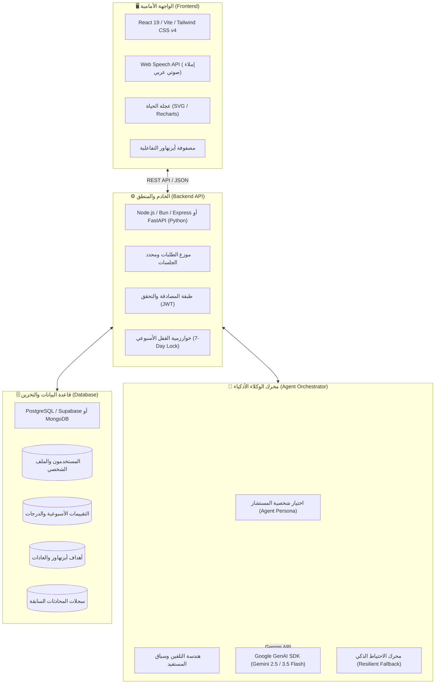

# 🚀 المخطط التنفيذي الشامل لبناء منصة تدبير (Tadbeer Blueprint)
### دليل المعمارية البرمجية، هندسة الوكلاء متعددي التخصصات، وخطة توزيع المهام على الفريق

---

## 🎯 1. الرؤية وجوهر المنصة (Product Philosophy)
**تدبير** ليست مجرد تطبيق مهام أو شات بوت تقليدي، بل هي **نظام حوكمة وإرشاد استراتيجي للحياة (AI Life Governance Platform)** يدمج بين:
1. **عجلة الحياة المتوازنة (Wheel of Life)** المقسمة إلى 8 مجالات حياتية رئيسية.
2. **فريق من 8 مستشارين أذكياء مستقلين (Multi-Agent System)** يمثل كل منهم تخصصاً دقيقاً (روحي، مالي، مهني، صحي، أسري، اجتماعي، نفسي، معرفي) بالإضافة إلى **المنسق العام (Director Agent)**.
3. **طقس التقييم الإكلينيكي الأسبوعي المقفل (Weekly Assessment Ritual)**: جلسة استماع مركزة من محطتين وتشخيص نهائي، تُقفل أسبوعياً لمدة 7 أيام للتفرغ للتطبيق العملي.
4. **مصفوفة أيزنهاور الذكية (Eisenhower Matrix)**: ربط نصائح المستشارين تلقائياً بالمربع الثاني (المهم غير العاجل) لمنع الأزمات وبناء العادات.
5. **غرف الاستشارة الحرة والمفتوحة**: مساحة دائمة للحوار والنقاش غير المقيد في أي وقت.

---

## 🏗️ 2. المعمارية التقنية المقترحة (Full-Stack Architecture)

---

## 👥 3. تقسيم الأدوار والمهام بين الفريق (Team Task Allocation)

لإنجاز المشروع بأعلى كفاءة وسرعة، يتم تقسيم الفريق إلى **3 إلى 4 تخصصات رئيسية**:

### 🎨 العضو الأول: مهندس الواجهات وتجربة المستخدم (Frontend & UI/UX Lead)
* **المسؤولية الأساسية:** بناء واجهات التطبيق التفاعلية وسلاسة الاستخدام على الموبايل والكمبيوتر.
* **المهام التفصيلية:**
  1. **تصميم نظام التصميم (Design System):** الألوان المستوحاة من الطبيعة والهدوء (الأخضر الزمردي `#1b605b`، البيج الدافئ `#FAF7F2`، الذهبي الوقور `#bd9240`).
  2. **بناء مكون عجلة الحياة التفاعلي (Interactive Wheel of Life):** رسم بياني راداري قطبي يعرض درجات الجوانب الثمانية مع مؤشر التوازن العام.
  3. **واجهة عيادة التقييم الأسبوعي (`OnboardingScreen`):**
     * تنفيذ واجهة المحادثة التفاعلية.
     * بطاقات الخيارات السريعة للأرقام (1-10) والعوائق الشائعة.
     * بطاقة القفل الأسبوعي (🔒) مع العداد التنازلي للأيام المتبقية.
     * مؤشر اكتمال الأبعاد (Progress bar: X من 8).
  4. **واجهة استشارة المستشارين (`AdvisorChatScreen`):**
     * قائمة التبديل بين المستشارين الثمانية.
     * القائمة المنسدلة لاختيار نمط التفكير (سريع ⚡ / متوازن ⚖️ / عميق 🧠).
     * أزرار إضافة التوصيات مباشرة لمصفوفة أيزنهاور بضغطة واحدة.
  5. **واجهة مصفوفة أيزنهاور (`EisenhowerMatrixScreen`):**
     * المربعات الأربعة مع السحب والإفلات أو النقل التلقائي، والفلترة حسب الجانب أو المستشار.
  6. **دعم الإدخال الصوتي باللغة العربية (Web Speech API).**

---

### 🧠 العضو الثاني: مهندس الذكاء الاصطناعي وهندسة التلقين (AI & Prompt Engineer)
* **المسؤولية الأساسية:** صياغة شخصيات المستشارين الثمانية، ضبط استجابات الذكاء الاصطناعي، وبناء محرك الوكلاء.
* **المهام التفصيلية:**
  1. **ملفات شخصيات الوكلاء (Agent System Prompts):**
     * كتابة برومبت متقن لكل مستشار في ملف Markdown مستقل داخل مجلد `Agents/`:
       * `01-spiritual.md`: د. سفيان الروحي (السكينة، الصلاة، التدبر، التحرر من القلق الوجودي).
       * `02-financial.md`: أ. كمال المالي (الميزانية، صندوق الطوارئ، ترشيد الاستهلاك، الاستثمار).
       * `03-health.md`: د. ريان الصحي (النوم، الحركة، التغذية، إدارة الطاقة الجسدية).
       * `04-career.md`: م. طارق المهني (المسار الوظيفي، الإنتاجية، المهارات النوعية).
       * `05-personal.md`: د. ليلى الذاتية (الوعي الذاتي، إدارة المشاعر، كسر التسويف).
       * `06-learning.md`: بروفيسور زياد المعرفي (القراءة، أدوات الذكاء الاصطناعي، التفكير النقدي).
       * `07-family.md`: د. مريم الأسرية (جودة الوقت، بر الوالدين، الاستقرار الأسري).
       * `08-social.md`: أ. سامي الاجتماعي (انتقاء الأقران، الذكاء الاجتماعي، العطاء).
       * `09-aggregator.md`: تقرير المنسق العام (تحليل الفجوات والتعارضات بين المجالات).
  2. **تطبيق أنماط التفكير المتعددة (Thinking Modes):**
     * النمط السريع (Fast ⚡): إجابات مباشرة وعملية لا تتجاوز فقرتين.
     * النمط المتوازن (Balanced ⚖️): توازن بين الدعم النفسي والتوجيه الإجرائي.
     * التحليل العميق (Deep Thinker 🧠): تفكيك سيكولوجي واستراتيجي لجذور المشكلة.
  3. **إلزام الموديل بالردود المهيكلة (Structured JSON Schema):**
     * إرجاع الرد بصيغة JSON صارمة تحتوي على: `reply`، `actionSteps`، و `reflectionQuestion`.
  4. **بناء محرك الاحتياط الذكي (Contextual Fallback Engine):**
     * لضمان عدم توقف الموقع أو تكرار الكلام في حال نفاذ كوتا الـ API أو انقطاع الاتصال، بناء دوال توليد ذكية تتفاعل مع كلام المستفيد وتمنحه ردوداً سياقية دافئة.

---

### ⚙️ العضو الثالث: مهندس الواجهة الخلفية وقواعد البيانات (Backend & Database Architect)
* **المسؤولية الأساسية:** تصميم قواعد البيانات، منطق الأعمال، ونقاط الربط البرمجية (REST APIs).
* **المهام التفصيلية:**
  1. **تصميم قاعدة البيانات (Database Schema):**
     * جدول المستخدمين: `users (id, name, email, password_hash, created_at)`.
     * جدول التقييمات الأسبوعية: `weekly_evaluations (id, user_id, area_id, score, evaluation_date, is_locked)`.
     * جدول الأهداف ومصفوفة أيزنهاور: `eisenhower_goals (id, user_id, title, quadrant, area_id, advisor_name, is_completed)`.
     * جدول رسائل المحادثات: `chat_messages (id, user_id, area_id, sender, content, created_at)`.
  2. **برمجة نقاط الـ API الرئيسية:**
     * `POST /api/auth/register` & `POST /api/auth/login` (نظام الدخول والتسجيل).
     * `POST /api/gemini/advisor-chat`: استقبال رسالة المستخدم، استدعاء الوكيل المختص، وإرجاع الرد والخطوات.
     * `POST /api/evaluations/submit`: رصد درجة المستشار، وتفعيل القفل الأسبوعي (حفظ تاريخ الإنجاز).
     * `GET /api/evaluations/status`: جلب حالة القفل للأبعاد الثمانية والأيام المتبقية للتجديد.
     * `GET /api/dashboard/summary`: تجميع درجات عجلة الحياة وأهداف أيزنهاور للمستخدم الحالي.
     * `POST /api/gemini/director-summary`: توليد تقرير المنسق العام الشامل بناءً على درجات المجالات الثمانية.
  3. **منطق القفل الأسبوعي (Weekly Locking Business Logic):**
     * منع إعادة فتح جلسة التقييم لنفس الجانب إلا بعد مرور 7 أيام (أو فجر يوم الاثنين/الجمعة حسب اليوم المعتمد لبداية الأسبوع).

---

### 🛡️ العضو الرابع (أو مشترك): مدير المنتج، الجودة، والنشر (Product, QA & DevOps)
* **المسؤولية الأساسية:** ضمان اتساق تجربة المستخدم، اختبار السيناريوهات، وإطلاق الموقع.
* **المهام التفصيلية:**
  1. **اختبار رحلة المستخدم (User Journey Testing):**
     * تجربة مسار التقييم الأسبوعي: التحقق من التوقف بعد 3 محطات وإقفال الجانب بنجاح.
     * التحقق من زر الانتقال لـ "استشارة المستشارين" عند القفل.
     * التأكد من فتح شاشة الداشبورد تلقائياً فور اكتمال 8 من 8.
  2. **إدارة المتغيرات البيئية والأمان (`.env`):**
     * حماية مفاتيح API (Gemini API Key)، وتشفير كلمات المرور عبر `bcrypt`.
  3. **نشر وتجهيز المشروع (Deployment):**
     * النشر السحابي (Vercel أو Netlify للواجهة، و Render أو Railway أو Fly.io للخلفية، و Supabase لقاعدة البيانات).
     * ربط الدومين وتفعيل شهادة الحماية SSL.

---

## 📅 4. خطة الإنجاز الزمنية المقترحة (5-Phase Roadmap)

| المرحلة (Sprint) | المدة | المخرجات الرئيسية |
| :--- | :---: | :--- |
| **المرحلة 1: التأسيس والتصميم** | 3 - 5 أيام | تصميم الواجهات، إعداد React + Vite + Tailwind، وتصميم جداول قاعدة البيانات. |
| **المرحلة 2: محرك الوكلاء الـ 8** | 4 - 6 أيام | كتابة برومبتات المستشارين في `Agents/`، وربط Gemini API مع دعم أنماط التفكير والردود المهيكلة. |
| **المرحلة 3: عيادة التقييم والقفل** | 4 - 5 أيام | بناء جلسة التقييم الإكلينيكية (3 خطوات)، القفل الأسبوعي لـ 7 أيام، وبناء عجلة الحياة التفاعلية. |
| **المرحلة 4: أيزنهاور والمنسق العام** | 3 - 4 أيام | بناء مصفوفة أيزنهاور التفاعلية، إضافة التوصيات التلقائية، وبرمجة تقرير المنسق العام الشامل. |
| **المرحلة 5: المراجعة، الصوت والنشر** | 3 - 5 أيام | دمج الإدخال الصوتي العربي، اختبار الحالات الاستثنائية والاحتياطية، ونشر المشروع برابط عام. |

---

## 💡 5. أسرار نجاح استخلصناها من كود تدبير الفعلي
1. **لا تجعل التقييم استجواباً طويلاً:** جلسة العيادة الأسبوعية يجب أن تكون قصيرة ودافئة (استماع للرضا 1-10 ⬅️ استكشاف العائق الأكبر ⬅️ تشخيص وعادة ذهبية واحدة ⬅️ إقفال).
2. **الفصل التام بين التقييم والاستشارة:** التقييم يفتح أسبوعياً فقط لغرض القياس، بينما غرفة الاستشارة مفتوحة طوال الوقت للنقاش الحر.
3. **الربط الإجرائي الفوري:** المستشار لا يعطي نصائح نظرية عامة، بل يقدم دائماً خطوات صغيرة (Micro-habits) قابلة للإسقاط فوراً في مصفوفة أيزنهاور.
4. **المتانة ضد انقطاع الـ AI:** دائماً ضع محرك ردود احتياطي (Fallback Engine) ذكي وسياقي، بحيث لو تأخرت الاستجابة أو استهلكت الكوتا، لا يشعر المستخدم بأي خطأ أو جمود.
